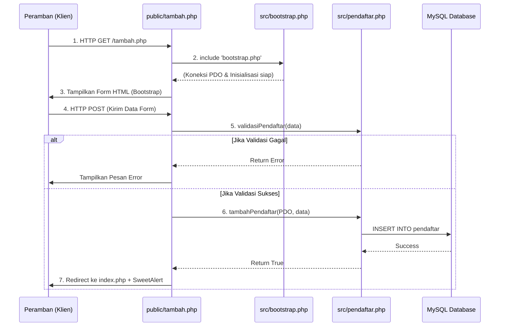
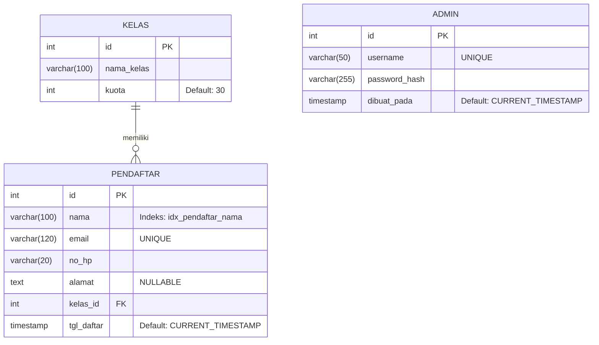

# Arsitektur Sistem Pendaftaran Pelatihan

Dokumen ini menjelaskan arsitektur perangkat lunak dari Sistem Pendaftaran Pelatihan, yang mencakup struktur direktori, alur permintaan (_request flow_), dan desain basis data (_Entity-Relationship Diagram_).

---

## 1. Struktur Folder dan Berkas

Aplikasi ini menggunakan pola arsitektur berbasis titik masuk (_entry point_) di dalam folder `public/`, yang memisahkan antara logika aplikasi (inti) dengan berkas yang bisa diakses langsung oleh peramban (_browser_).

```text
pendaftaran/
├── config/             # Konfigurasi aplikasi
│   ├── config.php      # Kredensial database (di-generate dari config.contoh.php)
├── database/           # Skrip dan skema basis data
│   ├── skema.sql       # Skema tabel (kelas, pendaftar, admin)
│   └── buat-admin.php  # Skrip CLI pembuat admin pertama
├── docs/               # Dokumentasi sistem dan laporan
│   ├── api/            # Hasil build JSDoc / phpDocumentor
│   ├── arsitektur.md   # [Berkas ini]
│   ├── peta-modul.md   # Pemetaan file src/ dan public/
│   └── daftar-library.md # Analisis library eksternal (Bootstrap, dll)
├── public/             # Titik masuk aplikasi (bisa diakses peramban)
│   ├── index.php       # Halaman utama (Daftar pendaftar/DataTables)
│   ├── login.php       # Halaman masuk admin
│   ├── logout.php      # Skrip keluar sesi admin
│   ├── tambah.php      # Formulir pendaftaran baru
│   ├── ubah.php        # Formulir ubah data pendaftar
│   ├── hapus.php       # Skrip hapus data
│   ├── cetak.php       # Cetak bukti PDF (menggunakan Dompdf)
│   └── _form.php       # Templat komponen (partial) untuk input form
├── src/                # Logika utama (tidak dapat diakses langsung oleh peramban)
│   ├── bootstrap.php   # Skrip inisialisasi awal (koneksi DB, pengaturan lingkungan)
│   ├── auth.php        # Modul autentikasi (wajibLogin, prosesLogin)
│   ├── pendaftar.php   # Modul CRUD dan logika validasi pendaftar
│   └── helpers.php     # Fungsi utilitas/bantuan (sanitasi, keamanan)
├── templates/          # Templat tampilan / layout (UI)
└── tests/              # Skrip pengujian otomatis
```

---

## 2. Alur Permintaan (Request Flow)

Aplikasi ini menggunakan pola **prosedural modular**. Setiap halaman di dalam `public/` bertindak sebagai _Controller_ sederhana yang memanggil logika dari folder `src/`.

Berikut adalah siklus standar ketika klien (_browser_) mengakses sebuah halaman (contoh: Menambah Pendaftar):



**Penjelasan Singkat:**

1. Pengguna membuka URL di folder `public/`.
2. Halaman tersebut wajib memuat `src/bootstrap.php` terlebih dahulu untuk menyiapkan fungsi bawaan dan koneksi _database_ (`PDO`).
3. Jika halaman butuh keamanan (misal `ubah.php` atau `hapus.php`), halaman akan memanggil `wajibLogin()` dari `src/auth.php`.
4. Jika ada proses simpan/hapus, logika diproses menggunakan fungsi dari `src/pendaftar.php`.
5. Hasil dikembalikan ke pengguna (berupa tampilan HTML atau notifikasi SweetAlert2/Flash message).

---

## 3. Entity-Relationship Diagram (ERD)

Berdasarkan berkas `skema.sql`, sistem basis data `db_pelatihan` terdiri dari tiga tabel utama.



**Keterangan Relasi:**

- **1 Kelas memiliki Banyak (_One-to-Many_) Pendaftar:** Setiap baris di tabel `pendaftar` memiliki `kelas_id` yang merujuk ke tabel `kelas`.
- **Restriksi Hapus (_ON DELETE RESTRICT_):** Sebuah kelas tidak dapat dihapus jika masih ada pendaftar yang terhubung pada kelas tersebut.
- **Tabel Admin Terpisah:** Tabel `admin` berdiri sendiri dan murni digunakan untuk modul `src/auth.php` (login/logout sesi).
